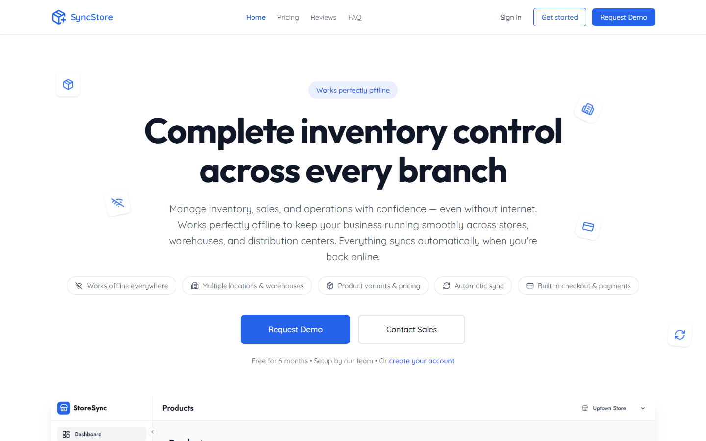
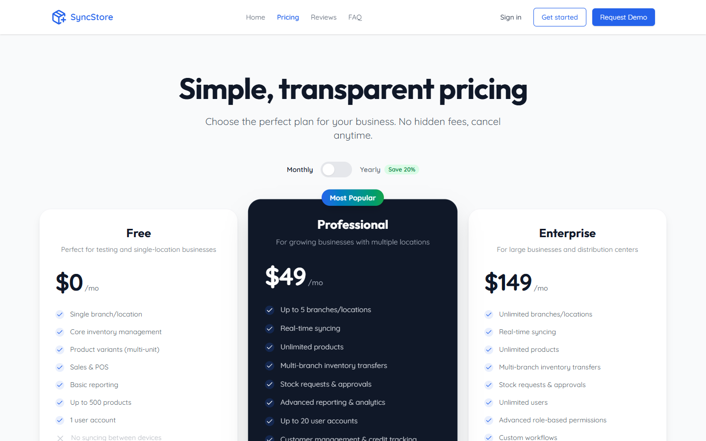
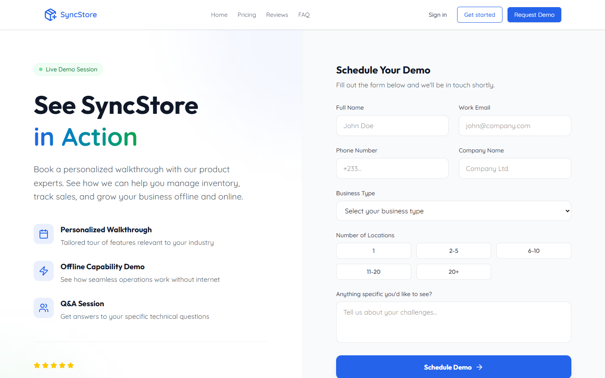
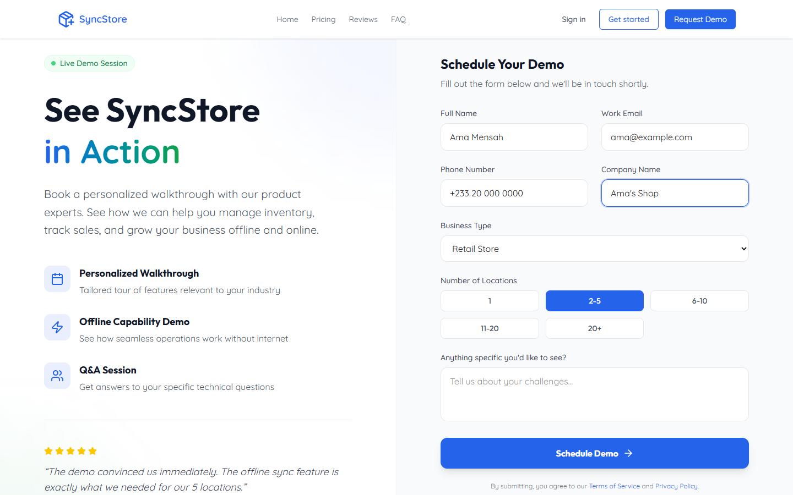
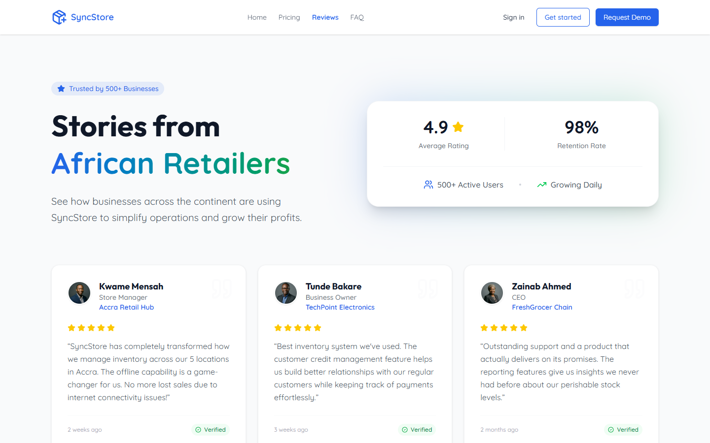
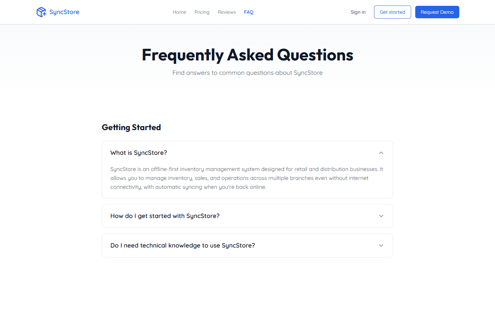
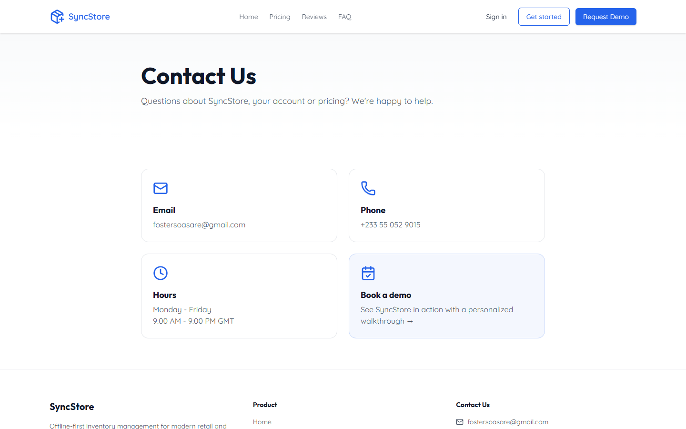
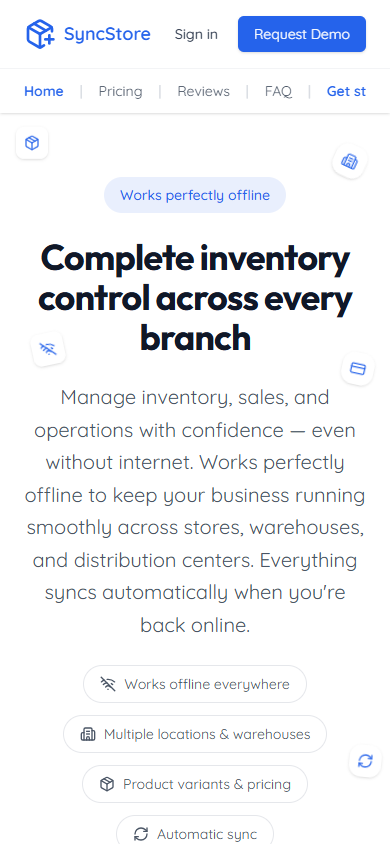

# SyncStore Website

The public website. It's where people **learn about SyncStore**, **compare plans**, **book a demo** and **create an account**.

> 👩‍💻 **Developers:** setup, settings and technical details are in [DEVELOPERS.md](DEVELOPERS.md).
> 📘 **New to SyncStore?** Start with the [main guide](../README.md).

---

## Contents

1. [Home page](#home-page)
2. [Pricing page](#pricing-page)
3. [Requesting a demo](#requesting-a-demo)
4. [Reviews page](#reviews-page)
5. [Frequently asked questions](#frequently-asked-questions-page)
6. [Contact page](#contact-page)
7. [Signing in and creating an account](#signing-in-and-creating-an-account)
8. [On a phone](#on-a-phone)
9. [Other pages](#other-pages)
10. [Common questions](#common-questions)

---

## The menu at the top

Every page has the same bar at the top:

| Item | What it does |
|---|---|
| **SyncStore** logo | Goes back to the home page |
| **Home, Pricing, Reviews, FAQ** | The main pages. The page you're on is shown in blue. |
| **Sign in** | For people who already have an account. Opens the setup app's sign-in page. |
| **Get started** | Create a new account. Opens the setup app's registration page. |
| **Request Demo** | Book a guided tour with the SyncStore team |

---

## Home page

The first page visitors see. It explains what SyncStore does: managing stock and sales across all your shops, **even without internet**.

As you scroll down you'll find:

- **Features**: what you can do with SyncStore
- **Numbers**: a few highlights about SyncStore
- **Why businesses choose SyncStore**: working offline, many branches, customer credit
- **How it works**: the four steps from request to running your business
- **Questions**: quick answers to common questions
- **Call to action**: buttons to request a demo or create your account

---

## Pricing page

Shows the available plans and what each includes. Each plan has a button to get started or contact the team.

---

## Requesting a demo

The **Request Demo** button (top right on every page) opens a form where you ask for a guided tour.

### How to fill in the form

1. Enter your **full name**
2. Enter your **work email**: the team will contact you here
3. Enter your **phone number**
4. Enter your **company name**
5. Choose your **business type** (retail, wholesale, pharmacy, restaurant, e-commerce or other)
6. Click how many **locations** (shops/warehouses) you have
7. Optionally, tell us **what you'd like to see**
8. Click **Schedule Demo**

### What happens next

- ✅ A green **"Request Received!"** message means your request was saved. The team will contact you to book a time.
- ❌ A red **"Something went wrong"** message means it wasn't sent. Check your details and try again. If it keeps happening, use the [contact page](#contact-page).

---

## Reviews page

What businesses using SyncStore say about it.

---

## Frequently asked questions page

Answers grouped by topic. Click a question to show its answer, and click it again to hide it.

At the bottom you can email support or request a demo if your question isn't answered.

---

## Contact page

How to reach the SyncStore team: email, phone, opening hours and a shortcut to book a demo. Open it from the **Contact** link at the bottom of any page.

---

## Signing in and creating an account

The website doesn't hold accounts itself. Its buttons take you to the **setup app**:

- **Sign in** opens the sign-in page
- **Get started** / **Create your account** opens the registration page

See the [setup app guide](../onboarding/README.md) for what happens next.

---

## On a phone

The website adjusts to small screens. The menu moves below the logo and sections stack on top of each other.

---

## Other pages

| Page | Where to find it | What it's for |
|---|---|---|
| **Terms of Service** | Link at the bottom of every page | The rules for using SyncStore |
| **Privacy Policy** | Link at the bottom of every page | What information is collected and how it's used |
| **Page not found** | Shown for any address that doesn't exist | Links back home and to support |

---

## Common questions

**I submitted the demo form. Will I get an email?**
Not automatically yet. Your request is saved and the team contacts you directly.

**I clicked "Sign in" and a different-looking page opened. Is that right?**
Yes. Signing in happens in the SyncStore setup app, which has its own look.

**Can I create an account without booking a demo?**
Yes. Click **Get started** at the top of any page.
